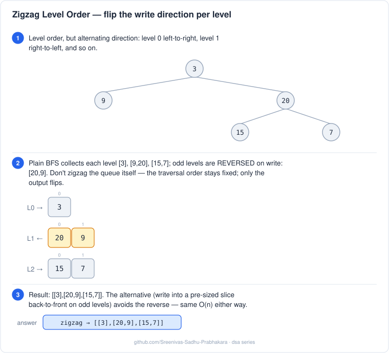

# Zig-Zag Traversal

> Striver SDE Sheet 122 · Day 18 Binary Tree II — plain BFS; a direction flag decides whether each level's slice fills forward or backward. Go, stdlib only, tested.

## Problem

Level order, but alternating direction: first level left-to-right, next right-to-left, and so on.

## Approach

Don't change the traversal — BFS always visits left to right; change only where each value *lands*. Pre-size the level slice (the queue snapshot gives the size up front) and write position `i` on rightward levels, `size−1−i` on leftward ones. No reversal pass, no deque juggling, no children pushed in alternating order (the approach that usually breeds bugs). Compare with #116's spiral, which reverses after the fact: same output family, and the two implementations are both worth knowing — post-reversal is simpler to reason about, direct placement avoids the second pass.

**Complexity:** O(n) time, O(widest level) space.

## Visual walkthrough

Read the picture top to bottom — each numbered frame is one moment of the algorithm
running on this repo's test example.

## Run

    go test ./...   # verify
    go run .        # demo

---

One of 191 repos solving Striver's SDE Sheet in Go — stdlib only, one problem per repo, every solution tested. Browse the set: [`dsa-*` repos](https://github.com/Sreenivas-Sadhu-Prabhakara?tab=repositories&q=dsa-&type=source).
